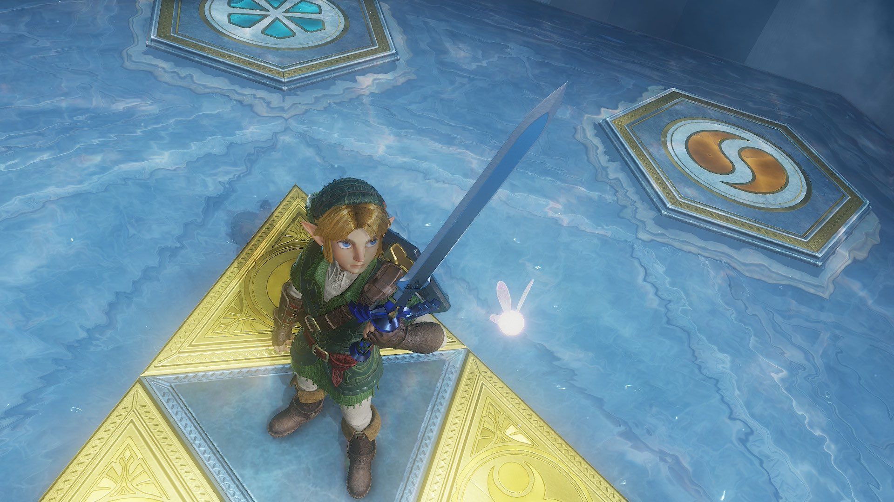
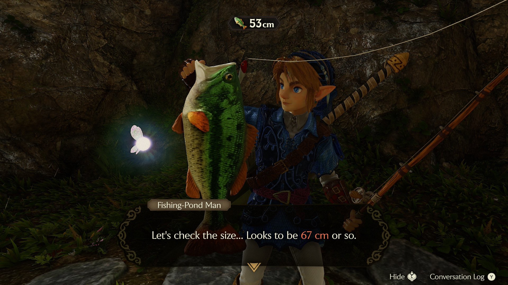

While i never owned the n64 version of this game, i still had plenty of nostalgia for this game. From watching content creators do speedruns or challenge runs I was really familiar with this game. I eventually ended up getting gifted the 3ds remake when that came out in 2011 and played it. I never finished the game (i think because i got stuck in the shadow and or spirit temple and was too young/dumb to look up guides online) though i loved it so so much.

I had initally bought the switch2 while on vacation in europe as kinda an birthday gift to myself and i think with this game there is finally a clear reason to own one. everything about this remake is honestly so perfect and even though the game came out in 1998 it doesnt feel dated at all. PLZ play this especially if youve never played a zelda game before. 

